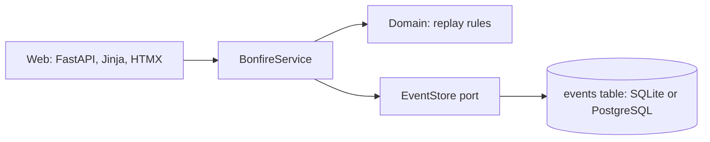

# DontYouDareGoHollow

A Souls-like study game for Japanese and the senior backend roadmap. Real study earns souls. Missing a day drops them as a bloodstain, and lighting the bonfire the next day gets them back. Miss again and they are gone.

This is **Phase 0 (Kindling)**: the bonfire, manual study logging, the souls ledger, bloodstains and hollowing. Automatic XP from Anki and GitHub comes in Phase 1.

## Running it

You need [uv](https://docs.astral.sh/uv/).

```sh
uv sync
uv run alembic upgrade head      # creates hollow.db (SQLite) by default
uv run uvicorn hollow.main:app --reload
```

Open http://localhost:8000.

With Docker and PostgreSQL instead:

```sh
docker compose up --build
```

Settings come from `HOLLOW_*` environment variables or a `.env` file; see `.env.example`. Set `HOLLOW_PASSWORD` before deploying anywhere public.

## The rules

| Rule | Detail |
| --- | --- |
| Lighting the bonfire | A day is lit when any one activity reaches its kindling amount: 10 Anki reviews, 5 new cards, 1 grammar drill, 5 minutes of study, or 1 merged PR. The big button logs 10 Anki reviews. |
| Souls | 2 per review, 5 per new card, 20 per drill, 2 per study minute, 100 per merged PR. |
| Death | A day that ends unlit is a death: held souls drop as a bloodstain, and any older bloodstain is lost. |
| Recovery | Light the bonfire on the next day to recover the bloodstain. |
| Hollowing | Each death adds one step (max 5) and fades your knight; each lit day removes one. |
| Game day | Days start at 04:00 Europe/Warsaw, so late-night study counts for the day before. |
| Messages | A message left today shows at the bonfire from tomorrow, "left by past you". |

## How it is built



The app is a small hexagonal (ports and adapters) monolith:

- `src/hollow/domain/` holds the pure game rules. Nothing is stored except events; souls, bloodstains, hollowing and streaks are all **replayed from the event log** (`world.replay`). Changing a rule rebalances history without migrating data.
- `src/hollow/application/` holds the use cases (`BonfireService`) and the ports they depend on (`EventStore`, `Clock`).
- `src/hollow/adapters/db/` is the SQLAlchemy event store, one append-only `events` table. Migrations are in `migrations/` (Alembic).
- `src/hollow/adapters/web/` is FastAPI with Jinja templates. Every form works without JavaScript; HTMX swaps the world panel in place.

## Checks

```sh
uv run pytest --cov     # tests
uv run ruff check .     # lint
uv run ruff format .    # format
uv run mypy             # strict type checks
```

CI runs all of these on every push and pull request, plus the migrations against PostgreSQL.

## Art

The pixel art is **placeholder**, generated by `tools/sprites/`:

```sh
uv run --with pillow python tools/sprites/sprites.py src/hollow/adapters/web/static/sprites
uv run --with pillow python tools/sprites/bonfire8.py src/hollow/adapters/web/static/sprites
```

A redesign is planned. Keep the file names and sizes, and new sprites drop in without touching the templates.
