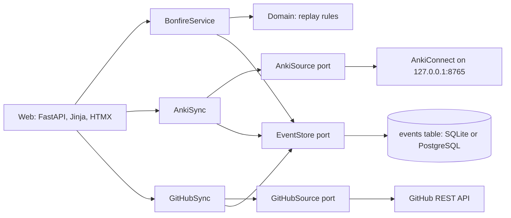

# DontYouDareGoHollow

A Souls-like study game for Japanese and the senior backend roadmap. Real study earns souls. Missing a day drops them as a bloodstain, and lighting the bonfire the next day gets them back. Miss again and they are gone.

Phase 0 (Kindling) built the bonfire, manual study logging, the souls ledger, bloodstains and hollowing. Phase 1 added automatic souls from Anki and GitHub, levelling, stats and Effigies. Phase 2 starts with **lessons**: て-form drills built from the verbs you have learned in Anki.

## Running it

You need [uv](https://docs.astral.sh/uv/).

```sh
uv sync
uv run alembic upgrade head      # creates hollow.db (SQLite) by default
uv run uvicorn hollow.main:app --reload
```

Open http://127.0.0.1:8000.

With Docker and PostgreSQL instead:

```sh
docker compose up --build
```

Settings come from `HOLLOW_*` environment variables or a `.env` file; see `.env.example`. Set `HOLLOW_PASSWORD` before deploying anywhere public.

## Anki sync

Souls for Anki come straight from your review log through the [AnkiConnect](https://ankiweb.net/shared/info/2055492159) add-on.

1. In Anki, install AnkiConnect (Tools, Add-ons, Get Add-ons, code `2055492159`) and restart Anki.
2. Copy `.env.example` to `.env`. Keep `HOLLOW_ANKI_ENABLED=true`, and set `HOLLOW_ANKI_DECKS` if you only want some decks to count (for example `Core 2000`). A deck counts together with its subdecks, and names must match Anki exactly.
3. With Anki open, open the app. Every page load syncs, and so does the bonfire button.

Rules for imported reviews:

- The first answer on a new card counts as a **new card** (5 souls). Every other answer, including learning steps, counts as a **review** (2 souls). Rescheduling a card is not study and does not count.
- Each review is imported once, keyed by Anki's own review id, so syncing again never double counts.
- Only reviews from the day the game started onwards count. Older Anki history is left out, otherwise every gap in it would replay as a death.
- With Anki sync on, Anki activities leave the manual log form, and the bonfire button syncs instead of logging 10 reviews.

To sync without opening the page, for example from Windows Task Scheduler:

```sh
uv run hollow-sync-anki
```

If the sync looks wrong or slow, this prints what the app sees in Anki: whether AnkiConnect answers and how fast, which decks are read, and today's reviews:

```sh
uv run hollow-anki-check
```

The Docker setup cannot see an Anki running on your desktop, because AnkiConnect only listens on localhost by default. Run the app with uv while using Anki sync.

## The rules

| Rule | Detail |
| --- | --- |
| Lighting the bonfire | A day is lit when any one activity reaches its kindling amount: 10 Anki reviews, 5 new cards, 1 grammar drill, 5 minutes of study, or 1 merged PR. The big button syncs Anki, or logs 10 reviews when Anki sync is off. |
| Souls | 2 per review, 5 per new card, 20 per drill, 2 per study minute, 100 per merged PR. |
| Effigies | You get 2 a week, refilled every Monday at 04:00 (they do not stack). A missed day uses one instead of killing you: no bloodstain, no hollowing, but the streak breaks. |
| Death | A day that ends unlit, with no Effigy left, is a death: held souls drop as a bloodstain, and any older bloodstain is lost. |
| Recovery | Light the bonfire on the next day to recover the bloodstain. |
| Hollowing | Each death adds one step (max 5) and fades your knight; each lit day removes one. |
| Levelling | Spend held souls at the bonfire to raise a stat by one. Each level bought costs more: 200 + 40 x soul level. Spent souls are safe from bloodstains. |
| Stats | Vigor: +10 max HP in boss fights. Endurance: mistakes cost 1 HP less (35 down to 20). Faith and Intelligence unlock extras for the Ronin and the Architect. No stat ever locks study. |
| Jobs | Ronin (Japanese) and Architect (Python) level from the souls you earn in them, which are never lost. Level n to n+1 takes 100 x n XP. Character level is the sum of both. |
| Game day | Days start at 04:00 Europe/Warsaw, so late-night study counts for the day before. |
| Messages | A message left today shows at the bonfire from tomorrow, "left by past you". |

## Lessons

Lessons are short typed drills, grouped by Ronin region on `/lessons`. The tab lists only lessons you can play now; the rest (short of verbs, or in a region still sealed) stay off it, counted in one line that says what opens them next. Firelink Shrine covers the て-form, one lesson per sound change (る-verbs, う・つ・る → って, む・ぶ・ぬ → んで, く・ぐ → いて・いで, す → して, する and 来る) plus a mixed one.

Undead Village covers the plain forms, built on the て-form: 〜ている (what is happening: 読んでいる), 〜た (what already happened: 読んだ, the same sound changes with た and だ), 〜ない for る-verbs, する and 来る (食べない, しない, 来ない), 〜ない for う-verbs (the last kana moves to the あ-row, う becomes わ: 書かない, 買わない), 〜なかった (書かなかった), and a mixed one that asks each form in turn. ある and いる sit out the 〜ている drill, and ある's negative is just ない. The village and its lessons stay sealed until the て-form Warden falls.

- Questions only use verbs you have learned: every Anki sync imports the notes in your decks whose cards are no longer new. Lessons open once you know enough verbs of that kind.
- Type the form the lesson asks for with your Japanese keyboard. Kana or kanji both count (食べて or たべて). A wrong answer shows the right one and how it is built.
- A lesson clears at 80% and lights the bonfire. First clear pays 5 souls per correct answer; a due refresher pays 60%; practice before it is due pays 25%.
- Cleared lessons come back as refreshers after 1, 3, 7, 21 and 60 days. A refresher at 90% or better moves to the next interval.
- The word fields default to the Core 2000 deck (`Vocabulary-Kanji`, `Vocabulary-Kana`, `Vocabulary-English`, `Vocabulary-Pos`). Another deck can set `HOLLOW_ANKI_WORD_FIELD`, `HOLLOW_ANKI_KANA_FIELD`, `HOLLOW_ANKI_MEANING_FIELD` and `HOLLOW_ANKI_POS_FIELD`.

## Maps

`/map` has two roads; pick one at the top and the map remembers it. The Ronin road is the six Japanese regions, from Firelink Shrine to the Kiln, in ember and bone. The Architect road is the eight backend regions, from the Forge to the Distributed Abyss, in cold steel and soul cyan, with the Lords of Design listed beside it. On both, a region is open once the boss before it falls; the rest are in the fog.

On both world maps each region is its painted landmark. On the Ronin road: the shrine, the village, the catacombs, the fortress, the golden city and the burning peak, outlined in gold on hover. On the Architect road: the smithy, the flooded vault, the citadel, the ruined towers, the watchtower, the iron keep and the crypt stair, outlined in cyan, with the Distributed Abyss swirling in the sky above them all. Regions still in the fog sit under a veil. `/map/firelink` is the first region: the bonfire, one rune stone per て-form lesson and the Warden's fog gate, the bonfire and the gate being landmarks too. Click a place, or use the arrow keys, and the knight walks there; Enter (or clicking the place you stand on) opens it. Stones glow gold once cleared and flicker when a refresher is due. The map remembers where you stopped. `/map/architect/forge` is the Forge, a vast cold forge hall: its bonfire, one iron obelisk per step on the floor and the stairs, and the Golem's chained gate. `/map/architect/data-depths` is Data Depths, a flooded archive of stone tablets and their ghost copies, with causeways to the Lock Wyrm's vault door. On every region map the bonfire and the boss's gate are landmarks too. Place labels near a map's edge open inward, so they fit on a phone.

The maps of both roads are generated paintings run through the ASHEN pixel pipeline (see [Art](#art)), with the points in `hollow.domain.atlas` placed on their landmarks. A landmark's rough outline (`area` in the atlas) is snapped to the painted building by GrabCut when `ronin.py` runs, which writes its hover glow (`spot_<map>_<place>.png`) and fog veil (`veil_world_<region>.png`).

## Boss fights

The fog gate at the top of Firelink Shrine leads to the first boss, the て-form Warden (`/boss/te-warden`). It opens once you know 6 verbs.

- Phase 1, Swift conjugation: the て-form of your verbs, 20 seconds per answer. Phase 2, Requests and sequences: 〜てください and 〜て、〜.
- Phase 3, the Warden's question: he speaks four lines ("Ask me, politely, to return", "Tell me what you do: first you wake up, then you eat") and you answer each in one Japanese sentence. Nothing is scored yet: the fight waits until the Sensei judges your replies in your next agent round (`hollow-agent-inbox` lists the task). 3 good replies of 4 fell the Warden; fewer, and he strikes you down, and the next attempt starts at his question. Good replies pay souls either way, and the fog gate shows the verdict, reply by reply, with the Sensei's corrections. Estus is useless here.
- Each right answer deals 10 damage and pays 5 souls, even in a lost fight. Each mistake (or running out of time) costs HP: 35, less with Endurance. You have 100 HP (more with Vigor and armour) and 2 Estus flasks of 50 HP (3 with the Golem's gauntlets).
- Dying never locks you out: try again straight away. The next attempt starts at the furthest phase you reached, and every death leaves the Warden 10% weaker, down to 70%.
- Leave mid-fight ("Rest at the fog gate") and the fight waits exactly as you left it.
- Felling the Warden pays 500 souls (750 on a first try) and lights the bonfire.

## Weapons and the blacksmith

Each job has its own weapon: Ronin weapons deal damage in Japanese fights, Architect weapons in dev fights. You start with a Rusted Katana and a Pilgrim's Shakujō, a monk's ringed staff (10 damage per hit). The blacksmith (`/blacksmith`, from the Character page or the Firelink bonfire) sells better basic weapons (the Uchigatana, the Surveyor's Shakujō), and bosses drop their own: the て-form Warden drops the Warden's Maul, whose Soul Siphon adds 15% to Ronin lesson souls while it is equipped.

The hero carries what you equip. On the home page, the character page and the maps he holds the weapon of the road you last walked (the map remembers it); in a fight he holds the one for that boss's road. Gauntlets such as Golem's Iron Fist are worn rather than held. The Architect's weapons were hammers until branch 20: events stored with the old ids (`worn-hammer`, `smiths-hammer`) are read as the two shakujō.

Reinforcing costs souls (200 x the new level) and titanite:

| Material | Reinforces | Where it drops |
| --- | --- | --- |
| Titanite Shard | +1 to +3 | Lessons scored 90% or better: a due refresher always on a perfect run (60% at 90%+), a new lesson 50% when perfect (25% at 90%+). After 4 good runs with no drop, the next good one drops for sure. Practice runs never drop. |
| Large Titanite Shard | +4 to +6 | Due refreshers from the 7-day interval on, bosses |
| Titanite Chunk | +7 to +9 | Bosses, every merged PR, every 100 new Anki cards |
| Titanite Slab | +10 | Bosses, your very first merged PR |

Each level adds 1 damage up to a boss's recommended level (+2 for the Warden) and half that beyond it, and every boss still needs at least 60% of its hits (at most 16 damage). A fight keeps the damage your weapon had when it began. Random drops are saved when they are rolled, so replays never change your loot.

## Armour

The hero wears up to four pieces of armour, one per slot (head, chest, arms, legs), on both roads. Each piece has one effect, applied by the game rules, and is drawn on the hero wherever he appears. Armour is never reinforced.

| Slot | Piece | Where | Effect |
| --- | --- | --- | --- |
| Head | Wanderer's Iron Hood | Bought at the blacksmith, 2,000 souls | +20 max HP in boss fights |
| Chest | Warden's Bronze Pauldrons | Dropped by the て-form Warden | Mistakes in boss fights cost 5 HP less (never below 20) |
| Arms | Golem's Riveted Gauntlets | Dropped by the Strict Golem | +1 Estus flask in every boss fight |
| Legs | Wyrm-scale Greaves | Dropped by the Lock Wyrm | Good lessons drop titanite 15 points more often |

Bosses you have already felled hand their piece over at once. Armour is put on and taken off at the blacksmith, whose page is split into Weapons, Armour, Rings and items (coming with the inventory; rings are worn but never drawn on the hero) and Recent finds. Like a weapon's damage, a fight keeps the HP, mistake cost and flasks it began with, so changing armour mid-fight changes nothing.

## Architect track

The Architect's road is the senior backend roadmap, played like the Japanese one. Every step lives in this repo as Markdown, one file each, under [`src/hollow/curriculum/architect`](src/hollow/curriculum/architect/README.md): eight skill regions (the Forge, Data Depths, the API Citadel, the Async Ruins, the Watchtower, the Iron Keep, the Undercroft and the Distributed Abyss) holding 82 steps. The roadmap starts from what you already do (Python, FastAPI, PostgreSQL, MongoDB, RabbitMQ, Kubernetes, AWS), so everyday basics are left out and the weight sits on the senior gaps. The Distributed Abyss is the largest region. Edit a step file and the game changes with it; `tests/test_architect.py` checks that every file still parses.

| Step | How it is checked | Pays |
| --- | --- | --- |
| Lesson and quiz | Read the step, then pass its quiz at 80% (an `arch:<step>` lesson run) | Like a Japanese lesson: 5 souls per right answer, refreshers after 1, 3, 7, 21 and 60 days |
| Prove (optional) | A Tech Lead exam at 80% or better, or a region's placement trial | 120 souls, once (placement: none) |
| Build | CI-checked challenges | coming later |

Clearing a step lights the bonfire and feeds the Architect job. When every step of a region is cleared, its boss waits behind the fog: the Forge's is the Strict Golem, a quiz fight over the Forge's steps (phase 2 against the clock), who drops Golem's Iron Fist. Data Depths' is the Lock Wyrm, three phases over its eleven steps (held rows; the planner's eye; the flooded deep, against the clock), tuned for a +3 weapon; he drops the Lock Wyrm's Chain (base 12, Soul Siphon) and two Titanite Chunks. Felling a boss opens the next region once its lessons are written and its map is charted; until then a region stays in the fog. Weapon damage on the character page and at the blacksmith is measured against the next Architect boss still standing. The nine Lords of Design (system design fights with the Tech Lead) open when the bosses of the regions they need have fallen.

## Agents

The Quest Master, Sensei, Lorekeeper and Tech Lead are Claude, during a session with you, following the playbooks in [`agents/`](agents/README.md). The app never calls a model. Agents create content and judge open-ended answers; the app validates what they return and does all the scoring.

## GitHub sync

Every merged pull request you open in your practice repo (by default [`MBigaj/hollow-trials`](https://github.com/MBigaj/hollow-trials)) is worth 100 souls and lights the bonfire on its own.

A pull request counts only when all of these hold:

- it is in one of `HOLLOW_GITHUB_REPOS`;
- you opened it (`HOLLOW_GITHUB_AUTHOR`);
- it was merged, not just closed, after the game began;
- its CI passed on the merged head commit. A pull request with no CI at all never counts, and one whose CI is still running is picked up by a later sync.

Commits never count on their own, so splitting work into tiny commits earns nothing. Each pull request is imported once, keyed by repo and number.

Setup:

1. Create a fine-grained token (GitHub, Settings, Developer settings, Fine-grained tokens) limited to the practice repo, with read-only **Pull requests**, **Commit statuses** and **Contents** access.
2. In `.env`, set `HOLLOW_GITHUB_ENABLED=true` and `HOLLOW_GITHUB_TOKEN=` to the token.
3. Open the app. Page loads sync at most every 5 minutes; the bonfire button always syncs. To sync from a scheduled task instead, run:

```
uv run hollow-sync-github
```

## How it is built



The app is a small hexagonal (ports and adapters) monolith:

- `src/hollow/domain/` holds the pure game rules. Nothing is stored except events; souls, bloodstains, hollowing and streaks are all **replayed from the event log** (`world.replay`). Changing a rule rebalances history without migrating data.
- `src/hollow/application/` holds the use cases (`BonfireService`) and the ports they depend on (`EventStore`, `Clock`).
- `src/hollow/adapters/db/` is the SQLAlchemy event store, one append-only `events` table. Migrations are in `migrations/` (Alembic).
- `src/hollow/adapters/web/` is FastAPI with Jinja templates. Every form works without JavaScript; HTMX swaps the world panel in place.

## Checks

```sh
uv run pytest --cov     # tests
uv run ruff check .     # lint
uv run ruff format .    # format
uv run mypy             # strict type checks
```

CI runs all of these on every push and pull request, plus the migrations against PostgreSQL.

## Art

Both roads are **generated art**, and so is the hero, a hollow ronin: one painting per sprite or scene, made with Figma AI (file "ASHEN source art") and kept in `tools/sprites/art/source/`, with the prompts in `PROMPTS.md` there. `tools/sprites/ronin.py` (golden dusk) and `tools/sprites/architect.py` (cold night) run each one through the ASHEN pixel pipeline (`tools/sprites/pipeline/pixelate.py` and the shared palette `ashen.hex`) at its native size, fixes what the pipeline loses (the eclipse's black, the Warden's crown, eyes and て sigil, the Golem's visor, the Wyrm's eye, the paths on the region maps), and scales the result up with NEAREST. It also builds:

- the bonfire (`bonfire.py`): the generated ash mound and a crisp greatsword, with an 8-frame flame that spirals up the blade and firelight that flickers on the stones, plus the cold, unlit bonfire;
- the home page stage: a shrine nook under the moon, cold until the day is lit, then warm around the fire.

`tools/sprites/weapons.py` (run after `ronin.py`) cuts every weapon out of one generated sheet (`weapons.jpg`) and makes, for each, a 72 px icon for the blacksmith and the character page and a layer on the hero's own canvas with its grip in his fist. The page stacks the hero, the weapon and his fingers (`hero_hand.png`), so any weapon fits the same sprite. `tools/sprites/items.py` does the same for the items: one sheet (`items.jpg`) holds the estus flask, the ember, the furigana lens, the phantom sign, the ring, the tome, the soul and the four grades of titanite, each a 48 px icon (the soul also comes at 28 px for the souls counters). It also pixelates the blacksmith's anvil from its own painting and draws the hit slash, a crescent cut, in code.

`tools/sprites/armour.py` (run after `weapons.py`) cuts the four armour pieces out of their sheet (`armour.jpg`) into 72 px icons, and paints each onto the hero's own silhouette as a layer, keeping his shading, in ASHEN ramps matched to its painting, with its details drawn in code. Where a piece sits is saved per slot (`FITS`), so every future head, chest, arms or legs piece lands in the same place and only brings its own look (`LOOKS`). The hood is worn under the kasa, framing his face; the gauntlets turn his hands to iron and bring their own fist over the weapon's handle. It also makes the Architect road's accent: his eye and scarf in soul cyan. The page stacks the hero, the accent (on the Architect road), the armour (legs, chest, arms, head), the weapon and the fingers.

```sh
uv run --with pillow --with numpy --with scipy --with opencv-python-headless \
    python tools/sprites/ronin.py src/hollow/adapters/web/static/sprites
uv run --with pillow --with numpy --with scipy --with opencv-python-headless \
    python tools/sprites/architect.py src/hollow/adapters/web/static/sprites
uv run --with pillow --with numpy --with scipy --with opencv-python-headless \
    python tools/sprites/weapons.py src/hollow/adapters/web/static/sprites
uv run --with pillow --with numpy --with scipy --with opencv-python-headless \
    python tools/sprites/items.py src/hollow/adapters/web/static/sprites
uv run --with pillow --with numpy --with scipy --with opencv-python-headless \
    python tools/sprites/armour.py src/hollow/adapters/web/static/sprites
```

The output is deterministic: running them again rewrites the same files. Icons are shown at their file size (two screen pixels per art pixel), so they stay crisp.

## Sound

The game has sound effects: the bonfire catching, souls flowing in, a titanite glint, the fog gate, blade strikes and blows in fights, estus, a boss's second wind, the boom of a felled boss, death, the anvil, coins, drawing a weapon, levelling up and footsteps on the maps. Lessons only get a soft ting for a right answer and a muted thunk for a wrong one. The ♪ in the header mutes everything; the choice is remembered in the browser. Without JavaScript there is no sound, and everything still works.

The server says what happened: an action's panel carries `data-sfx="souls drop"`, and `static/js/sound.js` plays those sounds when HTMX swaps the panel in. Sounds already on a page when it loads stay quiet, so a reload never replays a boss falling.

`tools/sounds/sounds.py` builds the MP3s in `static/sounds/`. Recordings cover what the world makes (a blade, a punch, an anvil, coins, footsteps, a bell), from Kenney's CC0 packs in `tools/sounds/source/` (see `LICENSE.md` there). Synthesis covers what nothing recorded covers (fire, fog, souls, the felled boss's boom, death's low tones) and the quiet lesson ticks. The big moments get a touch of stone-hall reverb.

```sh
uv run --with numpy --with scipy python tools/sounds/sounds.py src/hollow/adapters/web/static/sounds
```

It needs `ffmpeg` and is deterministic like the art scripts.

