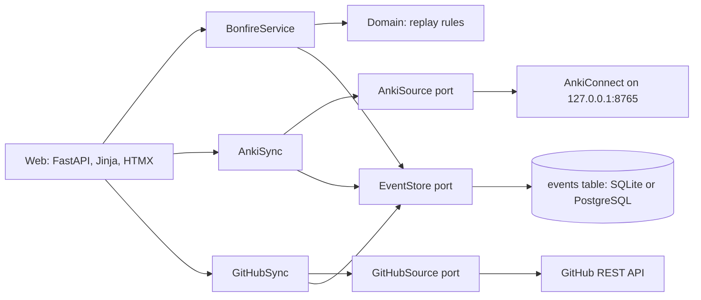

# DontYouDareGoHollow

A Souls-like study game for Japanese and the senior backend roadmap. Real study earns souls. Missing a day drops them as a bloodstain, and lighting the bonfire the next day gets them back. Miss again and they are gone.

Phase 0 (Kindling) built the bonfire, manual study logging, the souls ledger, bloodstains and hollowing. Phase 1 adds automatic souls: **Anki sync and GitHub sync are in**; levelling comes next.

## Running it

You need [uv](https://docs.astral.sh/uv/).

```sh
uv sync
uv run alembic upgrade head      # creates hollow.db (SQLite) by default
uv run uvicorn hollow.main:app --reload
```

Open http://127.0.0.1:8000.

With Docker and PostgreSQL instead:

```sh
docker compose up --build
```

Settings come from `HOLLOW_*` environment variables or a `.env` file; see `.env.example`. Set `HOLLOW_PASSWORD` before deploying anywhere public.

## Anki sync

Souls for Anki come straight from your review log through the [AnkiConnect](https://ankiweb.net/shared/info/2055492159) add-on.

1. In Anki, install AnkiConnect (Tools, Add-ons, Get Add-ons, code `2055492159`) and restart Anki.
2. Copy `.env.example` to `.env`. Keep `HOLLOW_ANKI_ENABLED=true`, and set `HOLLOW_ANKI_DECKS` if you only want some decks to count (for example `Core 2000`). A deck counts together with its subdecks, and names must match Anki exactly.
3. With Anki open, open the app. Every page load syncs, and so does the bonfire button.

Rules for imported reviews:

- The first answer on a new card counts as a **new card** (5 souls). Every other answer, including learning steps, counts as a **review** (2 souls). Rescheduling a card is not study and does not count.
- Each review is imported once, keyed by Anki's own review id, so syncing again never double counts.
- Only reviews from the day the game started onwards count. Older Anki history is left out, otherwise every gap in it would replay as a death.
- With Anki sync on, Anki activities leave the manual log form, and the bonfire button syncs instead of logging 10 reviews.

To sync without opening the page, for example from Windows Task Scheduler:

```sh
uv run hollow-sync-anki
```

If the sync looks wrong or slow, this prints what the app sees in Anki: whether AnkiConnect answers and how fast, which decks are read, and today's reviews:

```sh
uv run hollow-anki-check
```

The Docker setup cannot see an Anki running on your desktop, because AnkiConnect only listens on localhost by default. Run the app with uv while using Anki sync.

## The rules

| Rule | Detail |
| --- | --- |
| Lighting the bonfire | A day is lit when any one activity reaches its kindling amount: 10 Anki reviews, 5 new cards, 1 grammar drill, 5 minutes of study, or 1 merged PR. The big button syncs Anki, or logs 10 reviews when Anki sync is off. |
| Souls | 2 per review, 5 per new card, 20 per drill, 2 per study minute, 100 per merged PR. |
| Death | A day that ends unlit is a death: held souls drop as a bloodstain, and any older bloodstain is lost. |
| Recovery | Light the bonfire on the next day to recover the bloodstain. |
| Hollowing | Each death adds one step (max 5) and fades your knight; each lit day removes one. |
| Game day | Days start at 04:00 Europe/Warsaw, so late-night study counts for the day before. |
| Messages | A message left today shows at the bonfire from tomorrow, "left by past you". |

## GitHub sync

Every merged pull request you open in your practice repo (by default [`MBigaj/hollow-trials`](https://github.com/MBigaj/hollow-trials)) is worth 100 souls and lights the bonfire on its own.

A pull request counts only when all of these hold:

- it is in one of `HOLLOW_GITHUB_REPOS`;
- you opened it (`HOLLOW_GITHUB_AUTHOR`);
- it was merged, not just closed, after the game began;
- its CI passed on the merged head commit. A pull request with no CI at all never counts, and one whose CI is still running is picked up by a later sync.

Commits never count on their own, so splitting work into tiny commits earns nothing. Each pull request is imported once, keyed by repo and number.

Setup:

1. Create a fine-grained token (GitHub, Settings, Developer settings, Fine-grained tokens) limited to the practice repo, with read-only **Pull requests**, **Commit statuses** and **Contents** access.
2. In `.env`, set `HOLLOW_GITHUB_ENABLED=true` and `HOLLOW_GITHUB_TOKEN=` to the token.
3. Open the app. Page loads sync at most every 5 minutes; the bonfire button always syncs. To sync from a scheduled task instead, run:

```
uv run hollow-sync-github
```

## How it is built



The app is a small hexagonal (ports and adapters) monolith:

- `src/hollow/domain/` holds the pure game rules. Nothing is stored except events; souls, bloodstains, hollowing and streaks are all **replayed from the event log** (`world.replay`). Changing a rule rebalances history without migrating data.
- `src/hollow/application/` holds the use cases (`BonfireService`) and the ports they depend on (`EventStore`, `Clock`).
- `src/hollow/adapters/db/` is the SQLAlchemy event store, one append-only `events` table. Migrations are in `migrations/` (Alembic).
- `src/hollow/adapters/web/` is FastAPI with Jinja templates. Every form works without JavaScript; HTMX swaps the world panel in place.

## Checks

```sh
uv run pytest --cov     # tests
uv run ruff check .     # lint
uv run ruff format .    # format
uv run mypy             # strict type checks
```

CI runs all of these on every push and pull request, plus the migrations against PostgreSQL.

## Art

The pixel art is **placeholder**, generated by `tools/sprites/`:

```sh
uv run --with pillow python tools/sprites/sprites.py src/hollow/adapters/web/static/sprites
uv run --with pillow python tools/sprites/bonfire8.py src/hollow/adapters/web/static/sprites
```

A redesign is planned. Keep the file names and sizes, and new sprites drop in without touching the templates.
